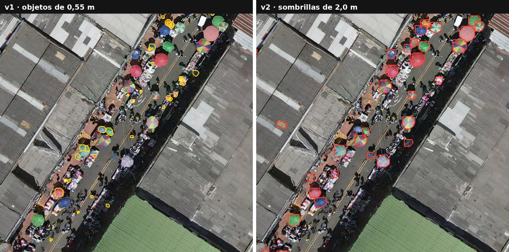
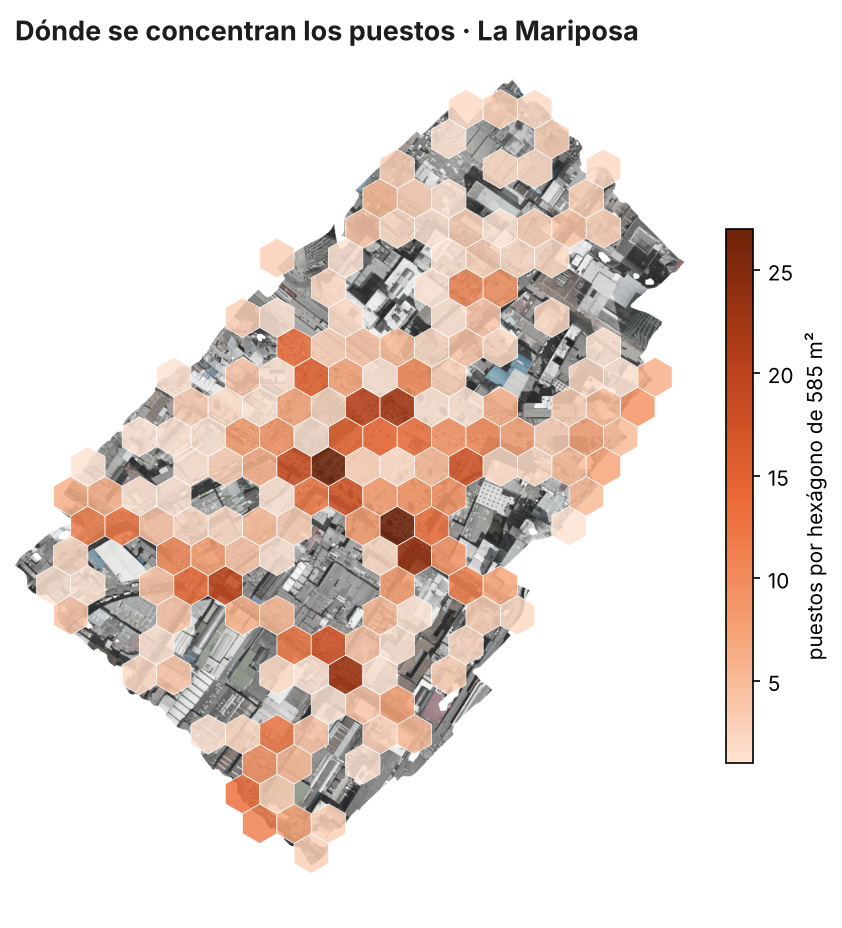
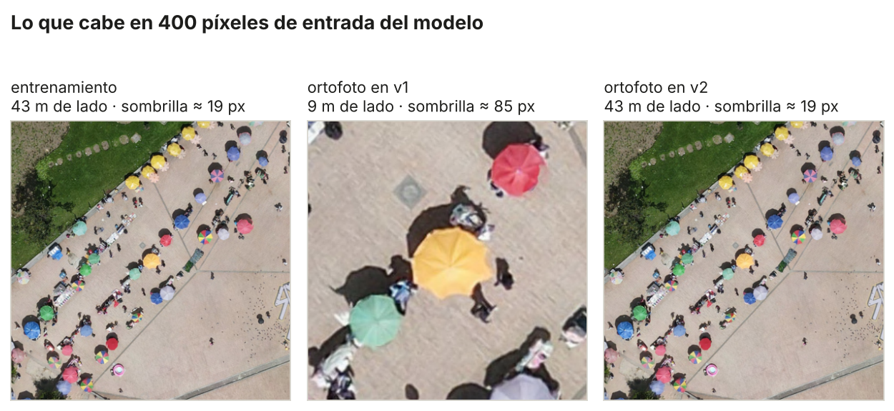

# UrbanVendor-Vision

[](https://github.com/Kzamudioq/urbanvendor-vision/actions/workflows/ci.yml)
<a href="https://colab.research.google.com/github/Kzamudioq/urbanvendor-vision/blob/main/notebooks/entrenar_v2_colab.ipynb"></a>

**Mapeo de puestos de venta informal desde un dron, usando la sombrilla como señal.** Un modelo YOLO26 de segmentación encuentra las sombrillas en fotos de 100 m de altura. Luego un pipeline geoespacial las ubica sobre la ortofoto completa, les mide el diámetro y muestra dónde se concentran.

Caso de estudio: sector de **La Mariposa**, centro de Bogotá. Vuelo con DJI Mavic Air 2 el 2 de diciembre de 2021, ortofoto a 3,45 cm/píxel.

<p align="center"></p>

## Resultados en La Mariposa

| | v1 | **v2** |
|---|---|---|
| Puestos detectados | 1.244 | **953** |
| Diámetro mediano | 0,55 m | **2,01 m** |
| Confianza mediana | 0,35 | **0,77** |

- La mitad de los puestos ocupa **32 hexágonos**, que suman **1 ha + 8706 m²**. En el más denso hay **27 puestos** en 585 m².
- La capa está en [`resultados/puestos_la_mariposa_v2.geojson`](resultados/puestos_la_mariposa_v2.geojson) (EPSG:3116). Cada polígono trae su confianza, área y diámetro. La densidad por hexágono está en [`resultados/densidad_la_mariposa_v2.geojson`](resultados/densidad_la_mariposa_v2.geojson).

<p align="center"></p>

## Qué fallaba en la versión 1

El modelo estaba bien entrenado. En las fotos de dron encuentra el 97 % de las sombrillas etiquetadas. **El error estaba en el paso a la ortofoto.**

- Para entrenar, las fotos se habían reducido a 0,4× en Roboflow y luego a `imgsz` 1500. Así, el modelo aprendió las sombrillas con unos **19 píxeles** de diámetro.
- En la ortofoto, las teselas de unos 1.024 píxeles entraban al modelo a 1.500. Eso las agrandaba, y cada sombrilla llegaba con unos **85 píxeles**: **4,5 veces más grande** de lo que el modelo conocía.
- Frente a eso, el modelo no reconocía las sombrillas. En cambio, marcaba objetos que a esa escala medían lo que una sombrilla en entrenamiento: tapas de alcantarilla, mercancía, cabezas. Por eso el diámetro mediano daba 0,55 m.

<p align="center"></p>

La corrección es una sola regla: **la ventana que se lee de la ortofoto tiene que medir `imgsz × GSD del modelo / GSD de la ortofoto`**. Con 1504 px de entrada, eso da 4.636 píxeles. [`escala.py`](src/urbanvendor/escala.py) la calcula a partir de la altura y la cámara que el dron guarda en cada foto, para que no dependa de recordar cuánto se redujo cada imagen.

Además de la escala, v2 corrige otras cosas:
- **Duplicados entre teselas.** Las detecciones que tocan un borde interior se descartan, porque la ventana vecina ve el objeto completo. Las demás pasan por una supresión de duplicados entre polígonos. En v1 había 206 pares de detecciones a menos de 1 m entre sí.
- **Máscaras reales.** v1 exportaba cajas. v2 exporta el polígono de la sombrilla y calcula su área en m².
- **Filtro físico.** Se descarta lo que no puede ser una sombrilla de venta: confianza menor a 0,4 o diámetro menor a 1,2 m. En las fotos etiquetadas, esto sube la precisión de 0,74 a 0,88 y conserva el 96 % de los aciertos. Casi todos los falsos positivos eran objetos rojos o azules de menos de un metro: tanques, avisos, bolsas.

## Qué tan bueno es el modelo

Se evaluó en las 12 fotos etiquetadas en Labelme (562 sombrillas). Cuenta como acierto una máscara con IoU ≥ 0,5 frente a la etiqueta.

| Fotos | Sombrillas | Precisión | Recall | F1 |
|---|---|---|---|---|
| Usadas en el entrenamiento (9) | 454 | 0,87 | 0,97 | 0,92 |
| Validación y prueba de v1 (3) | 108 | 0,79 | 0,94 | 0,86 |

Hay que leer estas cifras con cuidado:
- **Las tres fotos de "validación y prueba" no son independientes.** Cada foto cubre unos 142 × 107 m. DJI_0675 se tomó a 26 m de una foto de entrenamiento y DJI_0765 a 21 m: comparten la mayor parte del terreno y de las sombrillas. Por eso el mAP50 de 0,89 a 0,92 que reportaba Ultralytics en v1 es optimista. La tabla anterior también lo es.
- **La precisión está subestimada.** Algunas sombrillas que el modelo encuentra no fueron etiquetadas y cuentan como error.
- Para tener una cifra honesta está [`notebooks/entrenar_v2_colab.ipynb`](notebooks/entrenar_v2_colab.ipynb). Ese cuaderno re-entrena a **escala nativa** (teselas de 1.024 px, 3,6 cm/píxel) con **validación cruzada por zona**: el vuelo se parte en dos zonas a más de 140 m y cada modelo se evalúa en la zona que no vio. Su resultado reemplazará esta tabla.

## Uso

```bash
pip install -e ".[modelo]"

# escala: GSD de la foto y ventana correcta para la ortofoto
python -m urbanvendor escala --foto DJI_0729.JPG --reduccion 0.4 0.8356 --gsd-raster 0.0345 --imgsz 1504

# ortofoto completa -> GeoJSON de puestos (polígonos, confianza, área, diámetro)
python -m urbanvendor ortofoto --raster la_mariposa.tif --pesos best.pt --imgsz 1504 --gsd-modelo 0.1065

# densidad en hexágonos de 15 m de lado
python -m urbanvendor densidad --puestos puestos.geojson --lado 15

# dataset v2 desde Labelme: teselas nativas y pliegues por zona sin fugas
python -m urbanvendor dataset --fotos etiquetas/ --salida ds/ --lado 1024

# evaluación foto por foto, con la distancia a la foto de entrenamiento más cercana
python -m urbanvendor evaluar --fotos etiquetas/ --pesos best.pt --entrenamiento DJI_0674 DJI_0729 ...
```

## Estructura

```
src/urbanvendor/
  escala.py     GSD desde EXIF/XMP de DJI, GSD efectivo tras redimensionar, ventana equivalente
  ortofoto.py   ventanas a escala, bordes, georreferencia, supresión de duplicados entre teselas
  densidad.py   malla hexagonal y conteos
  datos.py      Labelme -> YOLO-seg en teselas nativas, zonas por distancia, pliegues
  evaluar.py    emparejamiento IoU, precisión/recall, control de fugas por distancia
notebooks/entrenar_v2_colab.ipynb   re-entrenamiento con validación cruzada por zona (T4)
scripts/figuras.py                  figuras de este README desde la ortofoto y los GeoJSON
tests/                              11 pruebas sobre una ortofoto sintética y casos de borde
```

## Datos

- **Etiquetas:** [UrbanVendor-Vision en Roboflow Universe](https://universe.roboflow.com/data-augmentation-qodgs/urbanvendor-vision), CC BY 4.0. Son 562 sombrillas en 12 fotos, etiquetadas a mano en Labelme como `puesto_sombrilla`.
- **Pesos:** los pesos entrenados no se publican.

---

<sub>Karen Tatiana Zamudio Quintero · ingeniera topográfica, piloto de dron · [LinkedIn](https://www.linkedin.com/in/karen-tatiana-zamudio-6b1747154/) · Ver [LICENSE](LICENSE).</sub>
