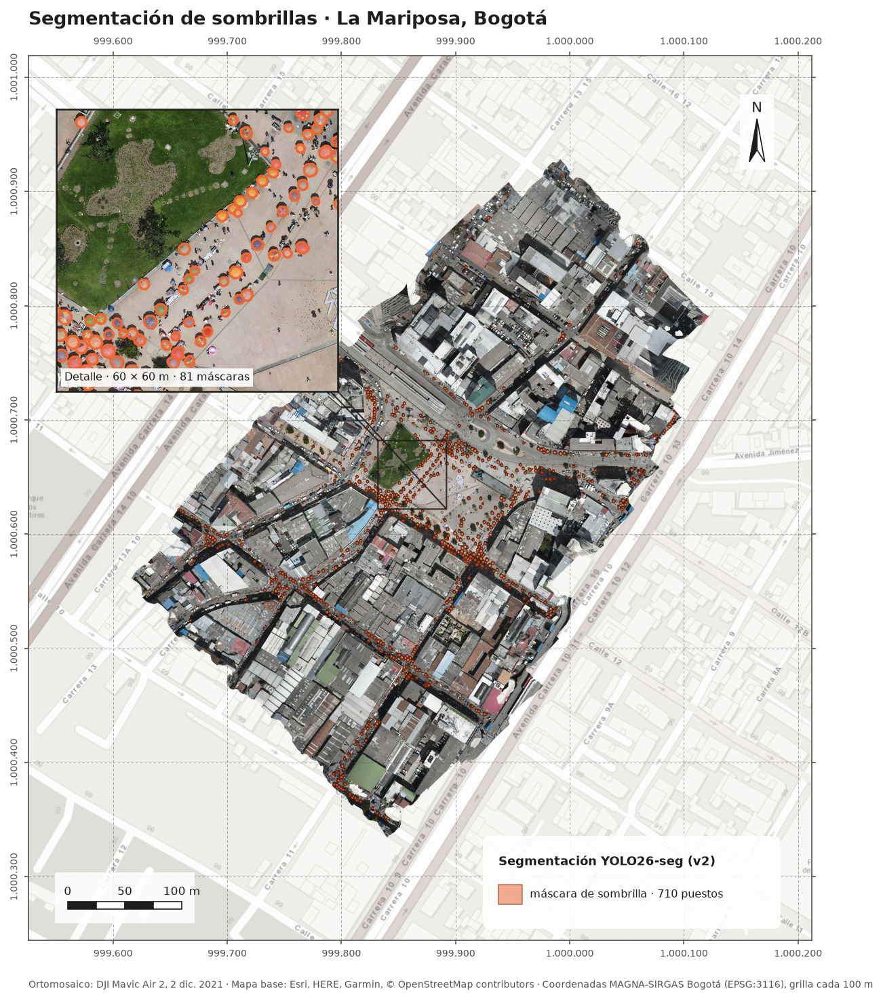
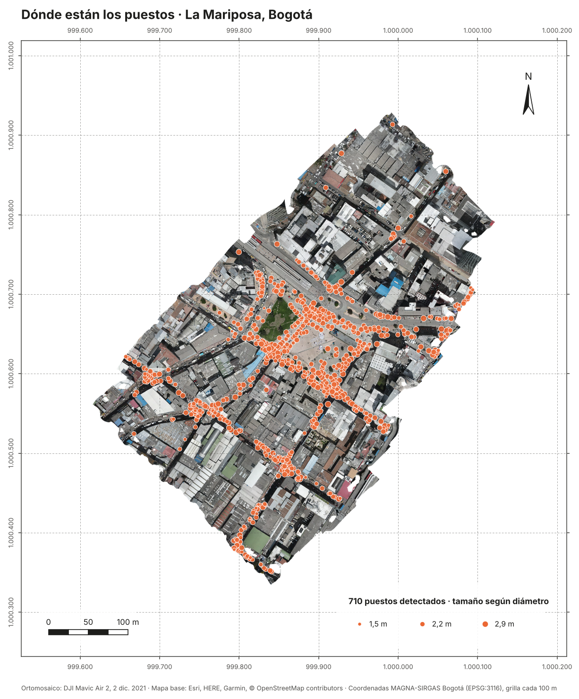

# UrbanVendor-Vision

[](https://github.com/Kzamudioq/urbanvendor-vision/actions/workflows/ci.yml)
<a href="https://colab.research.google.com/github/Kzamudioq/urbanvendor-vision/blob/main/notebooks/entrenar_v2_colab.ipynb"></a>

**Mapeo de puestos de venta informal desde un dron, usando la sombrilla como señal.** Un modelo YOLO26 de segmentación encuentra las sombrillas en fotos de 100 m de altura. Luego un pipeline geoespacial las ubica sobre la ortofoto completa, les mide el diámetro y muestra dónde se concentran.

Caso de estudio: sector de **La Mariposa**, centro de Bogotá. Vuelo con DJI Mavic Air 2 el 2 de diciembre de 2021, ortofoto a 3,45 cm/píxel.

<p align="center"></p>

<p align="center"><sub>Una misma calle de La Mariposa. A la izquierda, la versión 1: contornos amarillos sobre objetos de medio metro (mercancía, cabezas, tapas) mientras las sombrillas quedan sin marcar. A la derecha, la versión 2: un contorno rojo por cada sombrilla.</sub></p>

## Resultados en La Mariposa

| | v1 | v1 con escala corregida | **v2** |
|---|---|---|---|
| Puestos detectados | 1.244 | 953 | **710** |
| Diámetro mediano | 0,55 m | 2,01 m | **2,19 m** |
| Confianza mediana | 0,35 | 0,77 | **0,86** |
| Falsos positivos visibles | casi todos | techos, objetos pequeños | **casi ninguno** |

- La mitad de los puestos ocupa **22 hexágonos**, que suman **1 ha + 2860 m²**. En el más denso hay **28 puestos** en 585 m².
- **710 es un conteo conservador.** v2 casi no marca nada que no sea una sombrilla, pero en la ortofoto se le escapan algunas pequeñas o deformadas por el mosaico (ver *Qué tan bueno es el modelo*).
- La capa está en [`resultados/puestos_la_mariposa_v2.geojson`](resultados/puestos_la_mariposa_v2.geojson) (EPSG:3116). Cada polígono trae su confianza, área y diámetro. La densidad por hexágono está en [`resultados/densidad_la_mariposa_v2.geojson`](resultados/densidad_la_mariposa_v2.geojson).
- Un punto por puesto, con coordenadas planas, latitud y longitud y un enlace a Google Maps: [`resultados/centroides_la_mariposa_v2.csv`](resultados/centroides_la_mariposa_v2.csv). Se abre en Excel o como capa de puntos en QGIS.

### Tres mapas, del detalle al patrón

Los tres mapas tienen el mismo marco: el ortomosaico del vuelo sobre un mapa de calles en gris, con una grilla de coordenadas planas cada 100 m, escala gráfica y norte. Cada uno responde una pregunta distinta.

**1. Segmentación: ¿qué encontró el modelo?**

<p align="center"></p>

Cada mancha naranja es la máscara de una sombrilla: el contorno que el modelo YOLO26-seg dibujó sobre la imagen, no un punto ni una caja. A la escala de todo el sector las máscaras se ven pequeñas, porque una sombrilla de 2 m es un detalle dentro de 600 m de ortomosaico. Por eso el recuadro de arriba a la izquierda amplía 60 × 60 m junto al Parque La Mariposa, a 5 cm por píxel. Ahí se ve que cada máscara coincide con el borde de su sombrilla, y que las personas, los toldos sin sombrilla y la mercancía en el piso no se marcan. Las líneas unen el recuadro con su ubicación en el mapa general.

**2. Puestos: ¿dónde está cada uno?**

<p align="center"></p>

Cada máscara se reduce a su centroide, y cada puesto queda como un nodo con coordenadas, las mismas de [`centroides_la_mariposa_v2.csv`](resultados/centroides_la_mariposa_v2.csv). El tamaño del nodo depende del diámetro medido de la sombrilla, entre 1,2 y 2,9 m. Se lee la forma de la ocupación: los puestos no están repartidos al azar, sino en hileras a lo largo de los andenes, alrededor del parque y en las calles que salen de la plaza hacia el sur y el occidente. Las vías vehiculares y el interior de las manzanas quedan vacíos.

**3. Densidad: ¿dónde se concentran?**

<p align="center"></p>

Los puestos se cuentan en hexágonos de 15 m de lado (585 m² cada uno). El color va de durazno claro (1 puesto) a café oscuro (28 puestos), y la opacidad también crece con el conteo: donde hay pocos puestos se sigue viendo el terreno, y los focos quedan sólidos. Los hexágonos más oscuros están en la plaza, al costado oriental del parque y sobre el eje que baja hacia el sur. La mitad de todos los puestos cabe en 22 hexágonos, es decir, en **1 ha + 2860 m²**. Este es el mapa que sirve para priorizar dónde intervenir.

## Qué fallaba en la versión 1

El modelo estaba bien entrenado. En las fotos de dron encuentra el 97 % de las sombrillas etiquetadas. **El error estaba en el paso a la ortofoto.**

- Para entrenar, las fotos se habían reducido a 0,4× en Roboflow y luego a `imgsz` 1500. Así, el modelo aprendió las sombrillas con unos **19 píxeles** de diámetro.
- En la ortofoto, las teselas de unos 1.024 píxeles entraban al modelo a 1.500. Eso las agrandaba, y cada sombrilla llegaba con unos **85 píxeles**: **4,5 veces más grande** de lo que el modelo conocía.
- Frente a eso, el modelo no reconocía las sombrillas. En cambio, marcaba objetos que a esa escala medían lo que una sombrilla en entrenamiento: tapas de alcantarilla, mercancía, cabezas. Por eso el diámetro mediano daba 0,55 m.

<p align="center"></p>

<p align="center"><sub>Cada recuadro es lo que el modelo recibe en 400 píxeles. En v1 el modelo aprendió con 43 m de terreno por recuadro (sombrilla de 19 px), pero en la ortofoto recibía solo 9 m (sombrilla de 85 px): no la reconocía. En v2 entrenamiento y ortofoto usan la misma escala, 14 m por recuadro y sombrilla de 56 px.</sub></p>

La corrección es una sola regla: **la ventana que se lee de la ortofoto tiene que medir `imgsz × GSD del modelo / GSD de la ortofoto`**. Para el modelo v1 (1504 px de entrada) eso da 4.636 píxeles. v2 se entrenó sin reducir las fotos, así que la ventana es simplemente de 1.024 píxeles. [`escala.py`](src/urbanvendor/escala.py) la calcula a partir de la altura y la cámara que el dron guarda en cada foto, para que no dependa de recordar cuánto se redujo cada imagen.

Además de la escala, el pipeline nuevo corrige otras cosas:
- **Duplicados entre teselas.** Las detecciones que tocan un borde interior se descartan, porque la ventana vecina ve el objeto completo. Las demás pasan por una supresión de duplicados entre polígonos. En v1 había 206 pares de detecciones a menos de 1 m entre sí.
- **Máscaras reales.** v1 exportaba cajas. v2 exporta el polígono de la sombrilla y calcula su área en m².
- **Filtro físico.** Se descarta lo que no puede ser una sombrilla de venta: confianza menor a 0,4 o diámetro menor a 1,2 m. En las fotos etiquetadas, esto sube la precisión de 0,74 a 0,88 y conserva el 96 % de los aciertos. Casi todos los falsos positivos eran objetos rojos o azules de menos de un metro: tanques, avisos, bolsas.

## Qué tan bueno es el modelo

v2 se entrenó con las fotos **a su resolución original** (teselas de 1.024 px, 3,6 cm/píxel) y se evaluó con **validación cruzada por zona**. El vuelo se partió en dos zonas separadas más de 140 m, que es el ancho de una foto, para que ninguna sombrilla del conjunto de evaluación aparezca en el de entrenamiento. Cada modelo se entrenó en una zona y se evaluó en la otra.

| Pliegue | mAP50 (máscara) | mAP50-95 (máscara) | Precisión | Recall |
|---|---|---|---|---|
| Entrena en el norte, evalúa en el sur | 0,967 | 0,784 | 0,922 | 0,941 |
| Entrena en el sur, evalúa en el norte | 0,976 | 0,816 | 0,928 | 0,939 |

Datos en [`resultados/validacion_cruzada_v2.csv`](resultados/validacion_cruzada_v2.csv). Hay que tener en cuenta tres cosas:
- **Son cifras sobre fotos, no sobre la ortofoto.** En la ortofoto, el mosaico deforma algunas sombrillas, sobre todo las pequeñas y las que están junto a fachadas. En una calle de prueba conté unas 25 sombrillas visibles y v2 marcó 21. Por eso el conteo de la ortofoto es un mínimo. Para medir el recall directamente sobre la ortofoto habría que etiquetar una muestra de ella.
- **Las fotos se tomaron el mismo día, en el mismo vuelo y con la misma luz.** Un vuelo en otra fecha o a otra altura todavía no se ha probado.
- **La versión 1 no tenía una validación comparable.** Su mAP50 de 0,89 a 0,92 venía de fotos tomadas a 21 y 26 m de fotos de entrenamiento, que comparten casi todo el terreno. La evaluación foto por foto del modelo v1 está en [`resultados/evaluacion_fotos.csv`](resultados/evaluacion_fotos.csv).

## Uso

```bash
pip install -e ".[modelo]"

# escala: GSD de la foto y ventana correcta para la ortofoto
python -m urbanvendor escala --foto DJI_0729.JPG --reduccion 0.4 0.8356 --gsd-raster 0.0345 --imgsz 1504

# ortofoto completa -> GeoJSON de puestos (polígonos, confianza, área, diámetro)
python -m urbanvendor ortofoto --raster la_mariposa.tif --pesos best.pt --imgsz 1024 --gsd-modelo 0.0356

# densidad en hexágonos de 15 m de lado
python -m urbanvendor densidad --puestos puestos.geojson --lado 15

# un punto por puesto: coordenadas planas + lat/lon + enlace a Google Maps (CSV y GeoJSON)
python -m urbanvendor centroides --puestos puestos.geojson --salida centroides

# dataset v2 desde Labelme: teselas nativas y pliegues por zona sin fugas
python -m urbanvendor dataset --fotos etiquetas/ --salida ds/ --lado 1024

# evaluación foto por foto, con la distancia a la foto de entrenamiento más cercana
python -m urbanvendor evaluar --fotos etiquetas/ --pesos best.pt --entrenamiento DJI_0674 DJI_0729 ...
```

## Entrenar en tu computador (GPU NVIDIA)

En la carpeta del repositorio, con PowerShell o Anaconda Prompt:

```bash
python -m venv .venv
.venv\Scripts\activate
pip install torch torchvision --index-url https://download.pytorch.org/whl/cu128   # tarjetas RTX 50 necesitan CUDA 12.8
pip install -e ".[modelo]"
python scripts/entrenar_v2.py --fotos C:/Users/ktzam/Downloads/PONENCIA/etiquetas --orto C:/Users/ktzam/Downloads/PONENCIA/centro/la_mariposa.tif
```

El script hace lo mismo que el cuaderno de Colab y deja todo en `trabajo_v2/`: el dataset, `validacion_cruzada.csv`, los pesos (no se suben a git), `puestos_v2.geojson` y `densidad_v2.geojson`.

## Estructura

```
src/urbanvendor/
  escala.py     GSD desde EXIF/XMP de DJI, GSD efectivo tras redimensionar, ventana equivalente
  ortofoto.py   ventanas a escala, bordes, georreferencia, supresión de duplicados entre teselas
  densidad.py   malla hexagonal y conteos
  datos.py      Labelme -> YOLO-seg en teselas nativas, zonas por distancia, pliegues
  evaluar.py    emparejamiento IoU, precisión/recall, control de fugas por distancia
notebooks/entrenar_v2_colab.ipynb   re-entrenamiento con validación cruzada por zona (Colab, T4)
scripts/entrenar_v2.py              lo mismo, en un computador local con GPU
scripts/figuras.py                  antes/después y escala, desde la ortofoto y los GeoJSON
scripts/mapa_densidad.py            mapa de densidad sobre el ortomosaico (lo regenera GitHub Actions)
docs/base/la_mariposa_35cm.tif      copia liviana del ortomosaico (35 cm/píxel) para el mapa
tests/                              12 pruebas sobre una ortofoto sintética y casos de borde
```

## Datos

- **Etiquetas:** [UrbanVendor-Vision en Roboflow Universe](https://universe.roboflow.com/data-augmentation-qodgs/urbanvendor-vision), CC BY 4.0. Son 562 sombrillas en 12 fotos, etiquetadas a mano en Labelme como `puesto_sombrilla`.
- **Pesos:** los pesos entrenados no se publican.

---

<sub>Karen Tatiana Zamudio Quintero · ingeniera topográfica, piloto de dron · [LinkedIn](https://www.linkedin.com/in/karen-tatiana-zamudio-6b1747154/) · Ver [LICENSE](LICENSE).</sub>
